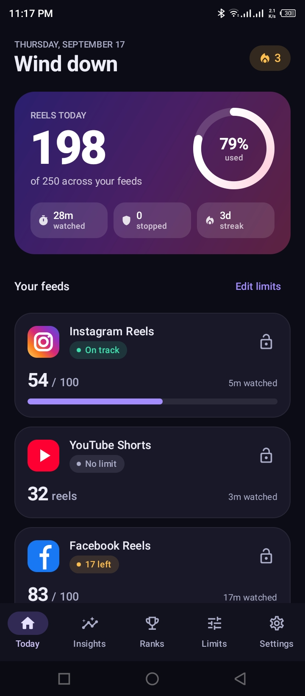
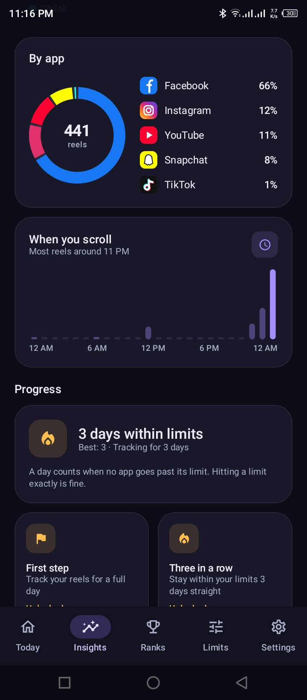
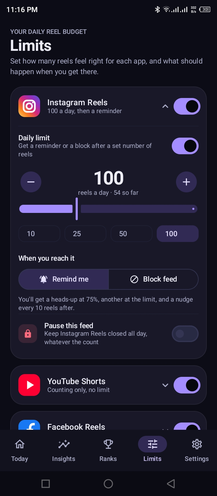
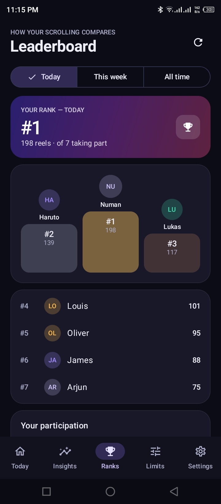

<div align="center">

# ReelWise: Reels Counter

### Understand your scrolling. Set limits. Build better digital habits.

ReelWise is an Android app that helps you understand and manage short-form video scrolling. It counts supported Reels and Shorts, lets you set daily limits, and turns your activity into useful insights.

[](https://play.google.com/store/apps/details?id=com.dvexo.reelguard)
[](https://kotlinlang.org/)
[](https://developer.android.com/)
[](https://developer.android.com/compose)

</div>

---

## About the Project

**ReelWise: Reels Counter** is an Android utility for people who want to be more intentional about short-form video consumption. Instead of tracking only screen time, ReelWise focuses on the number of short-form videos viewed and helps users understand their scrolling patterns.

| Project information | Details |
|---|---|
| App name | ReelWise: Reels Counter |
| Android package | `com.dvexo.reelguard` |
| Primary language | Kotlin |
| UI toolkit | Jetpack Compose |
| Distribution | Google Play |
| Repository | [github.com/abdullahalnuman0/reelwise](https://github.com/abdullahalnuman0/reelwise) |
| App download | [Google Play listing](https://play.google.com/store/apps/details?id=com.dvexo.reelguard) |

This GitHub repository is a public project showcase and documentation repository. It does not contain the Android application's source code.

## Key Features

### Automatic Reels & Shorts Counting

ReelWise uses Android's `AccessibilityService` to recognize supported short-form video feed activity in enabled apps and maintain platform-specific counts. Accessibility access must be enabled by the user in Android Settings.

### Daily Limits and Feed Controls

- Set daily short-video limits for supported platforms.
- Choose to receive a reminder when a limit is reached.
- Use the available feed-blocking option to help stop further short-form scrolling after reaching a limit.
- Review your progress against your daily limits.

### Insights and Activity History

- Review daily and historical reel counts.
- Compare activity across platforms.
- Explore scrolling patterns and trends over time.
- Track progress toward more intentional scrolling habits.

### Goals, Streaks, and Challenges

Set personal goals, build streaks, and take on challenges that encourage more consistent digital habits.

### Leaderboards

Where the optional account and cloud features are configured and available, users can compare aggregate progress through leaderboard and ranking features.

### Optional Accounts

ReelWise can provide optional account features using Firebase Authentication, including supported sign-in options. Core counting does not require users to sign in to Instagram, Facebook, TikTok, Snapchat, or YouTube.

## Supported Platforms

ReelWise is designed to count short-form video activity on these platforms:

| Platform | Supported content |
|---|---|
| Facebook | Facebook Reels |
| Instagram | Instagram Reels |
| TikTok | TikTok short-form video feed |
| Snapchat | Spotlight |
| YouTube | YouTube Shorts |

> **Compatibility note:** Detection depends on the relevant app's interface, accessibility events, Android version, and the version of each third-party app. Updates to third-party apps may affect detection or availability.

ReelWise is an independent utility. It is not affiliated with, sponsored by, endorsed by, or officially connected to Meta, Facebook, Instagram, TikTok, Snap Inc., Snapchat, Google, or YouTube. All product names and trademarks belong to their respective owners.

## Screenshots

The screenshots below are stored in [`assets/screenshot/`](assets/screenshot/).

<p align="center">
  
  
  
  
</p>

<p align="center">
  <sub>Dashboard</sub>&nbsp;&nbsp;&nbsp;&nbsp;&nbsp;&nbsp;&nbsp;&nbsp;
  <sub>Insights</sub>&nbsp;&nbsp;&nbsp;&nbsp;&nbsp;&nbsp;&nbsp;&nbsp;
  <sub>Daily Limits</sub>&nbsp;&nbsp;&nbsp;&nbsp;&nbsp;&nbsp;&nbsp;&nbsp;
  <sub>Leaderboard</sub>
</p>

## How It Works

1. **Enable Accessibility access:** The user explicitly enables ReelWise's AccessibilityService in Android Settings. This is required for automatic counting.
2. **Recognize feed activity:** ReelWise processes relevant accessibility events from supported apps to recognize short-form feed activity.
3. **Update counts and progress:** Recognized activity updates counts, platform breakdowns, daily limits, history, and progress.
4. **Store app data:** Room provides local database storage for supported app data and history.
5. **Use optional cloud features:** Firebase Authentication and Firebase Realtime Database support optional account-related and leaderboard/statistics features when configured.
6. **Show ads and consent messages:** Google Mobile Ads provides in-app advertising, while Google's User Messaging Platform (UMP) supports consent messages where applicable.

ReelWise does not need users' social-media passwords and does not sign in to those third-party services on their behalf. The counting feature is designed to recognize scrolling activity; it is not intended to upload screenshots, screen recordings, video or audio files, captions, comments, direct messages, or the general content displayed in monitored social-media apps.

## Technology Stack

| Technology | Purpose |
|---|---|
| **Kotlin** | Primary application language |
| **Jetpack Compose** | Declarative Android UI |
| **Material 3** | UI components and design system |
| **Navigation Compose** | In-app navigation |
| **AndroidX Lifecycle & ViewModel** | Lifecycle-aware UI state management |
| **Room** | Local database and persistence |
| **KSP** | Room code generation |
| **WorkManager** | Scheduled and deferrable background work |
| **Kotlin Coroutines** | Asynchronous and background operations |
| **Firebase Authentication** | Optional anonymous, email/password, and Google sign-in flows |
| **Firebase Realtime Database** | Optional cloud-backed leaderboard/statistics features |
| **Android Credential Manager + Google ID** | Google sign-in integration |
| **Google Mobile Ads SDK** | In-app advertising |
| **Google User Messaging Platform (UMP)** | Advertising consent messages where applicable |
| **JUnit, AndroidX Test, Espresso, Compose UI Test, Room Testing** | Unit and Android instrumentation testing |
| **Gradle Kotlin DSL** | Android build configuration |

## Privacy & Permissions

### Accessibility Permission

Automatic counting requires the user to explicitly enable ReelWise's AccessibilityService from Android Settings. The service is used to recognize supported short-form feed activity. Users can disable this access at any time; automatic counting stops when access is disabled.

### Data Handling

- Counting and history data are stored locally for core app functionality.
- Optional account features may use Firebase Authentication and cloud services for account-related information and aggregate statistics.
- ReelWise does not require credentials for third-party social-media accounts.
- The counting feature is not intended to upload the media or private content displayed inside monitored apps.
- Google Mobile Ads may process device, advertising, approximate-location, diagnostic, and ad-interaction signals under Google's policies and the user's consent/settings.

For full details, read the [ReelWise Privacy Policy](https://abdullahalnuman-dev.github.io/reel-wise/).

For information about third-party data processing, see the [Google Privacy Policy](https://policies.google.com/privacy) and [Firebase Privacy and Security information](https://firebase.google.com/support/privacy).

## Repository Structure

```text
reelwise/
├── README.md
└── assets/
    └── screenshot/
        ├── dashboard.png
        ├── insights.png
        ├── limits.png
        └── leaderboard.png
```

## Repository Scope

This repository is a **public documentation and project showcase** for ReelWise. It contains this README and app screenshots in `assets/screenshot/`.

The Android application's source code and build configuration are **not included**. As a result, this repository is not a clone-and-build distribution of the app. For the latest published release, refer to the [Google Play listing](https://play.google.com/store/apps/details?id=com.dvexo.reelguard).

## Download

<div align="center">

### Take a more intentional approach to short-form video scrolling.

[](https://play.google.com/store/apps/details?id=com.dvexo.reelguard)

[Open ReelWise on Google Play](https://play.google.com/store/apps/details?id=com.dvexo.reelguard)

</div>

## Contact

**Abdullah Al Numan** — Android Developer

- **Email:** [abdullahalnumanb@gmail.com](mailto:abdullahalnumanb@gmail.com)
- **GitHub:** [github.com/abdullahalnuman0](https://github.com/abdullahalnuman0)
- **Portfolio:** [abdullahalnuman0.github.io](https://abdullahalnuman0.github.io)
- **Project repository:** [github.com/abdullahalnuman0/reelwise](https://github.com/abdullahalnuman0/reelwise)

For app support, feedback, or bug reports, use the support email above or open an issue in this repository.

---

<div align="center">

**Built with Kotlin and Jetpack Compose.**

</div>
